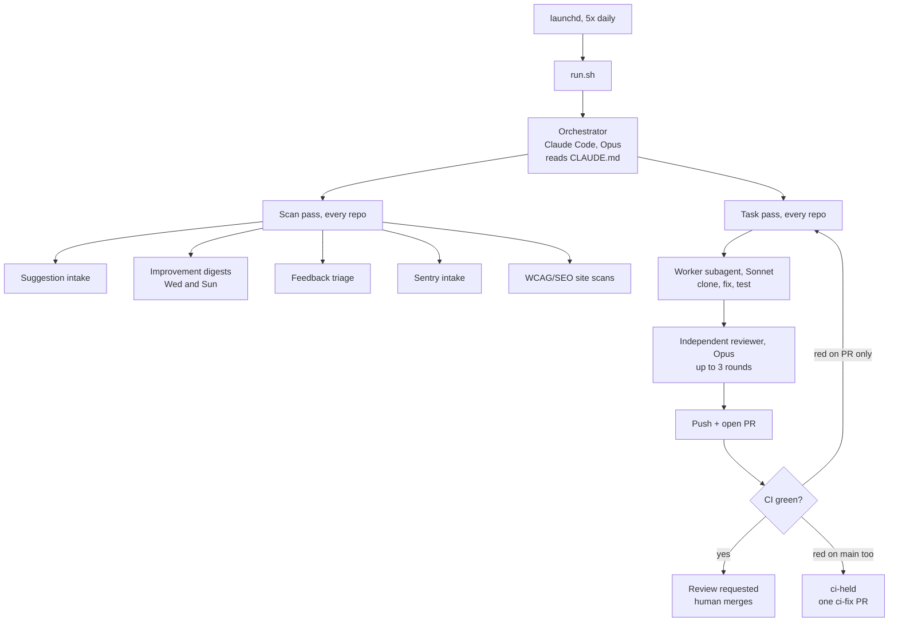

# agents

An unattended Claude Code orchestrator that maintains a fleet of GitHub repositories for one developer. Five times a day it reads each repo's issues and pull requests, delegates the work to subagents that each clone, fix, test, review, and open a PR, and requests a human review only once CI is green. The human merges; the agent does everything up to that point.

This repo is published as a working reference, not a product. It runs my real projects, it is opinionated about the stack it targets, and it assumes macOS. If you want to run your own, everything installation-specific is in one config file (see [Running your own](#running-your-own)).

## How it works



Each run has two passes:

1. **Scan pass** (cheap, always runs first). Turns signals into tracked work: follow-up suggestions left on PRs, a twice-weekly improvement digest per repo that the human triages by ticking boxes, end-user feedback, production errors from Sentry, and weekly accessibility and SEO scan findings.
2. **Task pass.** Works the queue in priority order: a red `main`, bugs, PRs that are behind or conflicting, failing CI, review feedback, Dependabot bumps, then P1 to P4 issues. One subagent per task.

Every worker runs the same checks CI runs before it pushes, then gets an independent review from a fresh Opus instance that did not write the code. Sonnet writes; Opus plans and checks.

### Where the human stays in the loop

- **Merging** is always the human's job.
- **Review is requested only on green CI**, so a review request means "ready to merge pending your eyes", never "go fix this".
- **`blocked`** stops the agent cold on an item. The human clears it.
- **Assignment is a handoff.** An item assigned to the human is skipped. Reassigning a `blocked` item to the agent account with a question gets it researched and answered, never worked.
- **Digests are a gate.** The agent proposes improvements; only the boxes the human ticks become issues.
- **Session limits.** When a run hits the plan's session limit, `run.sh` records it as a rate limit rather than a crash, and the next scheduled run picks up where it left off.

## Safety model

The orchestrator and its workers run unattended with `--dangerously-skip-permissions` and a GitHub token that can push workflow files. That is a deliberate tradeoff for an unattended box, and it makes untrusted text the main risk. The controls (see `## Untrusted Input` in [CLAUDE.md](CLAUDE.md)):

- **Untrusted text is filtered before it reaches a worker.** Inline comments, review bodies, and conversation comments all go through one committed filter ([`filters/trusted-comments.jq`](filters/trusted-comments.jq)) that keeps only repo owners, members, and collaborators. No bots are trusted by default: a bot that answers mentions repeats whatever a stranger asked it to say. Workers are told never to fetch comments themselves.
- **Untrusted-origin work is pushed by the orchestrator, not the worker.** For issues from end-user feedback, Sentry, or an outside author, the worker commits but never pushes. The orchestrator checks the change set with [`scripts/check-protected-paths.sh`](scripts/check-protected-paths.sh) and only pushes if it leaves `.github/`, env files, deploy config, `package.json`, and lockfiles alone; otherwise a human decides.
- **The feedback classifier has nothing to act with.** Raw end-user text is classified in a `claude -p` session limited to read-only tools inside a throwaway clone: no shell, no network, no files outside the clone.
- **Workers never see production credentials.** This box only holds local and e2e decryption keys; it never deploys.
- **Every e2e run gets a throwaway Neon database branch**, deleted unconditionally afterwards.
- **Workers write only inside their own `/tmp` clone.** Only the orchestrator and `run.sh` write logs and ledgers.

What this does not cover: workers run as the same OS user as everything else on the box, so the prompt rules and gates above stop a worker that has been *misled*, not one that has been *hijacked* into actively attacking. Anything that user can read, a hijacked worker can read. Keep credentials on the box down to the agent account's own; in particular, don't stay logged in to `gh` as the human reviewer, or a hijacked worker could approve and merge its own PRs.

## Reading this repo

| File | What it is |
| ---- | ---------- |
| [`CLAUDE.md`](CLAUDE.md) | The program. The orchestrator's full operating spec: task queue, prompt templates, retry limits, review gate, e2e procedure. |
| [`docs/improvement-scan.md`](docs/improvement-scan.md) | Sub-spec for the scan pass phases, read on demand to keep CLAUDE.md small. |
| [`agents.config.json`](agents.config.json) | Everything installation-specific. |
| [`run.sh`](run.sh) | The shell around the orchestrator: locking, log rotation, the background-wait ceiling, and detection of failure modes that exit quietly. |
| [`launchd/`](launchd/) | The schedule. |
| [`html-issue.md`](html-issue.md) | Issue template for features specced with a reference HTML design. |
| [`.claude/agents/`](.claude/agents/) | Project subagent definitions. |
| [`tests/`](tests/) | Guards for the spec, the config, and the shell around it (see [Development](#development)). |

Most of the interesting decisions are in comments and rationale lines in `CLAUDE.md` and `run.sh`. Each one exists because something broke.

## Running your own

### What it expects from target repos

- Node projects with npm scripts: `lint`, `lint:ci`, `test:ci`, and optionally `typecheck` and `e2e` (Playwright).
- A `ci` job in `.github/workflows/ci.yml` that the workers mirror locally.
- Secrets in [dotenvx](https://dotenvx.com/)-encrypted `.env` and `.env.e2e` files, and e2e databases on [Neon](https://neon.com/).
- Issues labeled `Bug` and `P1` to `P4`.

### Prerequisites

- macOS (launchd, `~/Library/Logs`)
- [Claude Code](https://docs.claude.com/en/docs/claude-code) on a plan with enough usage for unattended runs
- `gh`, `git`, `jq`, `direnv`, `python3`, Node and `npx` (`run.sh` checks for `jq` and `node` before every run)
- A separate GitHub account for the agent, with write access to every target repo (collaborator or org member) and a token scoped `repo` and `workflow`

### Setup

1. Clone this repo and edit [`agents.config.json`](agents.config.json):

   | Key | Purpose |
   | --- | ------- |
   | `identities.human` | Your GitHub login. Reviews, merges, owns `blocked` items. |
   | `identities.agent` | The agent's GitHub login. |
   | `trustedBots` | Bot logins whose PR comments count as review feedback. |
   | `repos.active` / `repos.disabled` | Target repo URLs, processed in order. Move a URL to `disabled` to pause it. |
   | `crossRepoDependencies` | Repos that build against another repo's API, with the read-only contract surface. |
   | `errorLog` | Path to a markdown error table, or `null` to disable it. A leading `~` is expanded. |
   | `sentry` | `enabled`, the org slug, and a repo-to-project map. |
   | `siteScans` | `enabled`, the directory holding `<domain> - WCAG.md` / `<domain> - SEO.md` scan files, and a repo-to-domain map. |

2. Run `npm install`. It installs the test tooling and the pre-commit hook, and from then on every commit in this directory runs lint and tests. That needs `jq`, `python3`, and `node` on the PATH; `shellcheck` and `gitleaks` are optional locally (skipped with a notice, enforced in CI). After a pull that changes `package.json` or the lockfile, the post-merge hook only reminds you to run `npm ci`; it never installs on its own.
3. Copy `.envrc.sample` to `.envrc`, fill it in (`claude setup-token` for the OAuth token), and run `direnv allow`.
4. For each repo with e2e tests, put its dotenvx decryption keys in `envs/<repo-name>.keys` (gitignored).
5. Install the schedule:

   ```bash
   sed -e "s#__WORKSPACE__#$PWD#g" -e "s#__HOME__#$HOME#g" -e "s#__PATH__#$PATH#g" \
     launchd/com.grimicorn.agents.plist > ~/Library/LaunchAgents/com.grimicorn.agents.plist
   launchctl bootout "gui/$(id -u)/com.grimicorn.agents" 2>/dev/null || true   # re-installs: unload the old job first
   launchctl bootstrap "gui/$(id -u)" ~/Library/LaunchAgents/com.grimicorn.agents.plist
   ```

   To use your own label, change it in three places together or `npm run launch` stops working: the plist's `Label`, the installed file name (`~/Library/LaunchAgents/<label>.plist`), and the `launch` script in `package.json`.

6. `npm run launch` starts a run immediately; `npm run logs` tails it.

### Known limitations

- **The usage meters aren't readable from a headless run.** The pre-run and mid-run usage checks in CLAUDE.md are specified but can't actually be evaluated, so `run.sh` catches the session-limit rejection after the fact instead.
- **macOS only.** The log paths and the scheduler assume it.
- **CI proves Linux, not macOS.** The `run.sh` tests run on `ubuntu-latest`, so they can't catch BSD-vs-GNU differences in `date`, `ps`, or `sed`. The pre-commit hook runs the same suite on the Mac before every commit, which is the only macOS coverage; there is no macOS CI job, to save billed minutes.
- **The stack is opinionated.** Swapping out GitHub, dotenvx, or Neon means editing the spec, not the config.

## Development

The program is markdown, so the tests guard what a markdown linter can't:

- **The trust boundary.** `filters/trusted-comments.jq` is tested directly, and the exact pipelines CLAUDE.md and the scan spec tell the orchestrator to run are pulled out of the docs and executed against fixture comments, so weakening one in prose fails CI. `scripts/check-protected-paths.sh` is tested against the paths it must block and lookalikes it must allow.
- **Spec hygiene.** No GitHub logins, Sentry org, or machine paths hardcoded outside `agents.config.json`; every `(see Section)` names a heading that exists; README links resolve.
- **Config.** `scripts/validate-config.mjs` checks `agents.config.json`: real GitHub URLs, no repo both active and disabled, booleans where switches belong, Sentry and site-scan maps only reference known repos. `run.sh` runs the same validator before every run.
- **`run.sh`.** Runs in a sandbox with stubbed `claude` and `direnv` to check the tool and config guards, the error table (including the `^errorTable` anchor), lock handling, and detection of failures that exit quietly.
- **`trim_logs.py` and the launchd template.**

```bash
npm run lint     # prettier (code and JSON only) + shellcheck run.sh scripts/*.sh
npm test         # vitest
```

Prettier skips markdown on purpose: it re-fences the nested code blocks in the CLAUDE.md prompt templates, which changes what workers receive. The pre-commit hook runs lint, tests, and a staged gitleaks scan; CI runs the same plus a full gitleaks scan.

## License

[MIT](LICENSE)
